<!--
*******************************************************************************
Copyright (c) 2026 Contributors to the Eclipse Foundation

See the NOTICE file(s) distributed with this work for additional
information regarding copyright ownership.

This program and the accompanying materials are made available under the
terms of the Apache License Version 2.0 which is available at
https://www.apache.org/licenses/LICENSE-2.0

SPDX-License-Identifier: Apache-2.0
*******************************************************************************
-->

# SOME/IP stack in io-sock: integration proposals

This document reviews the [SOME/IP-SD prototype](../README.md) and proposes how to integrate the lg-someip stack
(branch `pr/KOOBK/1498`, `score/lg-someip`) so that it can also run inside the QNX io-sock process.

## Issues with the current proposal

1. **Unnecessary architectural complexity.** The stack is split into an SD daemon (lg-someip `ServiceManager`,
   `SdOnlyRouter`, `SdFacade`), an io-sock event module and a client library in every application. This requires
   three IPC interfaces (`sd_protocol`, `event_module_protocol`, LoLa), three configurations that must match
   (lg-someip JSON, `mw_com_config.json`, the module's runtime tables) and has known gaps caused by the split itself:
   no resynchronization after an event module restart, and `add_route` called from a separate `SomeipSvcConn` thread.
2. **Duplicated code.** Most of the new connection code already exists in
   [socom](../../../inc_someip_gateway/score/socom) and
   [gateway_ipc_binding](../../../inc_someip_gateway/score/gateway_ipc_binding):

| Prototype (new) | Already available |
| --- | --- |
| [sd_protocol.h](../protocol/sd_protocol.h), `SdFacade`, `sd_client`: Register, RequestService, Subscribe, Offer, plus Availability and SubscriptionState notifications | socom service discovery, availability and `subscribe_event` / `unsubscribe_event`. `gateway_ipc_binding` carries these between processes. |
| `EventSample` (size, session, interface version, message type, payload), `someip/<svc>/<inst>` and `event_<id>` LoLa naming | [sample_layout.hpp](../../../inc_someip_gateway/score/gateway_ipc_binding/impl/sample_layout.hpp) (8-byte prefix + SOME/IP message in a LoLa slot) and the `bridged_services` configuration |
| "Event module gets all config at runtime, no JSON in io-sock" | `gatewayd` already sends its flatbuffer configuration to `someipd` at runtime (`SomeipdService`, `Add_bridged_services`) |
| New mw::com SOME/IP binding in every application (E2E, (de)serialization) with its own SD client | `gatewayd`'s `LocalServiceInstance` / `RemoteServiceInstance` already do serialization and SOME/IP header handling; they can move into the application's binding on top of `gateway_ipc_binding` (step 5) |
| [event_module_protocol.h](../protocol/event_module_protocol.h), `EventModuleClient`, `control_channel` | Only needed because of the split |

## Proposal 1 (recommended): the io-sock module is `someipd`

Treat io-sock as a second place to run the existing `someipd` component, next to running it as a normal process.
The SOME/IP stack is not split. Applications connect to `someipd` directly via `gateway_ipc_binding` (step 5) and
do not need to know where `someipd` runs.

## Target architecture

Steps 1, 3, 4 and 5 do not depend on io-sock and can be done and tested in user space first. In this state lg-someip
runs inside `someipd` with its existing POSIX `osabstraction` backend, and applications connect to `someipd` directly.
The startup code is shared between `main.cpp` and the module entry point, and the zero-copy path goes through socom
payloads, but the module can only be loaded into io-sock once the io-sock backend of step 2 exists.

```mermaid
flowchart LR
    subgraph asil_app["Application process"]
        asil_code["Application code<br/>mw::com proxy / skeleton"]
        subgraph asil_bind["mw::com SOME/IP binding [step 5]"]
            asil_ser["Serialization, SOME/IP header<br/>E2E protect / check<br/>[score, adapted] from gatewayd"]
            asil_socom["socom runtime [score]"]
            asil_client["gateway_ipc_binding client [score]"]
            asil_ser --> asil_socom --> asil_client
        end
        asil_code --> asil_ser
    end

    subgraph sd["someipd process (QM)"]
        startup["Shared startup [step 3]<br/>called by main.cpp,<br/>later by the io-sock module entry point<br/>[score, adapted]"]
        srv["gateway_ipc_binding server<br/>SomeipdService (runtime config)<br/>[score]"]
        sd_socom["socom runtime [score]"]
        svc["GatewaydServices<br/>LocalNetworkService / RemoteNetworkService<br/>[score, adapted]: vsomeip → lg-someip"]
        subgraph lg["lg-someip, replaces vsomeip [step 1]"]
            smgr["ServiceManager [LG]<br/>SD state machine"]
            router["SomeipRouter : ServiceRouter [new]<br/>SD + data routing,<br/>zero-copy RX / TX [step 4]"]
            osa["osabstraction: POSIX backend [LG]<br/>Multiplexer, UDP + TCP sockets"]
            smgr <--> router --> osa
        end
        startup -.-> srv
        startup -.-> svc
        srv --> sd_socom --> svc --> smgr
        svc --> router
    end

    kernel["Network stack<br/>QNX io-sock / Linux kernel<br/>(socket API)"]
    remote["Remote ECU"]

    asil_client -- "LoLa, zero-copy<br/>sample_layout: prefix + SOME/IP message<br/>availability, subscriptions" --> srv
    asil_client -. "SomeipdService<br/>flatbuffer config" .-> srv
    osa -- "recvmsg into LoLa slot /<br/>sendmsg from LoLa slot" --> kernel
    kernel -- "SOME/IP-SD UDP 30490<br/>SOME/IP UDP + TCP" --- remote

    subgraph legend["Legend"]
        direction LR
        l_lg["[LG] reused from lg-someip"]:::lg
        l_score["[score] reused from eclipse-score"]:::score
        l_adapted["[score, adapted] reused from eclipse-score,<br/>moved or changed"]:::adapted
        l_new["[new] to be implemented"]:::new
        l_platform["platform / existing / external"]:::platform
        l_lg ~~~ l_score ~~~ l_adapted ~~~ l_new ~~~ l_platform
    end

    classDef lg fill:#dae8fc,stroke:#6c8ebf,color:#000
    classDef score fill:#d5e8d4,stroke:#82b366,color:#000
    classDef adapted fill:#d5e8d4,stroke:#d79b00,stroke-width:2px,stroke-dasharray:5 3,color:#000
    classDef new fill:#ffe6cc,stroke:#d79b00,color:#000
    classDef platform fill:#f5f5f5,stroke:#666666,color:#000
    classDef proc fill:#ffffff,stroke:#333333,color:#000
    classDef group fill:none,stroke:#999999,stroke-dasharray:3 3,color:#000

    class smgr,osa lg
    class asil_socom,asil_client,srv,sd_socom score
    class asil_ser,startup,svc adapted
    class router new
    class asil_code,kernel,remote platform
    class asil_app,sd proc
    class asil_bind,lg,legend group
```

Removed compared to the prototype: `someip_sd_daemon`, `SdFacade`, `sd_client`, the user-space event module, and
the `sd_protocol` and `event_module_protocol` interfaces. Removed compared to today's gateway: `gatewayd`.

### Final target with io-sock module

With the io-sock `osabstraction` backend, the same component is loaded into io-sock on QNX. Only the bottom layer
of the stack and the host process change; on Linux it keeps running as the `someipd` process.

```mermaid
flowchart LR
    subgraph asil_app["Application process"]
        asil_code["Application code"]
        asil_bind["mw::com SOME/IP binding<br/>serialization, E2E,<br/>gateway_ipc_binding client<br/>[score, adapted]"]
        asil_code --> asil_bind
    end

    subgraph iosock["io-sock process (QNX)"]
        subgraph mod["mods-someipd.so"]
            entry["Module entry point [new, step 3]<br/>MOD_LOAD → shared startup"]
            core["someipd component [score, adapted]<br/>gateway_ipc_binding server, socom,<br/>GatewaydServices, shared startup"]
            smgr["ServiceManager [LG]"]
            router["SomeipRouter [new]"]
            osa_k["osabstraction: io-sock backend<br/>[new, step 2], glue from prototype<br/>so* kernel API, UDP + TCP,<br/>upcalls / kthread,<br/>RX mbuf → LoLa slot, TX MEXTADD"]
            entry --> core --> smgr <--> router --> osa_k
            core --> router
        end
        stack["TCP/UDP/IP stack"]
        osa_k --> stack
    end

    remote["Remote ECU"]

    asil_bind -- "gateway_ipc_binding<br/>(LoLa, zero-copy)" --> core
    stack -- "SOME/IP-SD, SOME/IP" --- remote

    subgraph legend["Legend"]
        direction LR
        l_lg["[LG] reused from lg-someip"]:::lg
        l_score["[score] reused from eclipse-score"]:::score
        l_adapted["[score, adapted] reused from eclipse-score,<br/>moved or changed"]:::adapted
        l_new["[new] to be implemented"]:::new
        l_platform["platform / existing / external"]:::platform
        l_lg ~~~ l_score ~~~ l_adapted ~~~ l_new ~~~ l_platform
    end

    classDef lg fill:#dae8fc,stroke:#6c8ebf,color:#000
    classDef score fill:#d5e8d4,stroke:#82b366,color:#000
    classDef adapted fill:#d5e8d4,stroke:#d79b00,stroke-width:2px,stroke-dasharray:5 3,color:#000
    classDef new fill:#ffe6cc,stroke:#d79b00,color:#000
    classDef platform fill:#f5f5f5,stroke:#666666,color:#000
    classDef proc fill:#ffffff,stroke:#333333,color:#000
    classDef group fill:none,stroke:#999999,stroke-dasharray:3 3,color:#000

    class smgr lg
    class asil_bind,core adapted
    class entry,router,osa_k new
    class asil_code,stack,remote platform
    class asil_app,iosock proc
    class mod,legend group
```

### Steps

1. **Rewrite `someipd` to use lg-someip instead of vsomeip.** `vsomeip` is used in about 11 places only (offer,
   request, subscribe, notify, message handler), all in
   [routing.cpp](../../../inc_someip_gateway/score/someipd/impl/routing.cpp),
   [local_network_service.cpp](../../../inc_someip_gateway/score/someipd/impl/local_network_service.cpp) and
   [remote_network_service.cpp](../../../inc_someip_gateway/score/someipd/impl/remote_network_service.cpp).
   These are replaced by lg-someip running inside the process; vsomeip is removed, there is no abstraction layer to
   support both stacks:
   - `ServiceManager` plus one `ServiceRouter` (`SomeipRouter`) that handles both SD and data. The router is
     basically `SdOnlyRouter`, `rx_router` and `tx_forwarder` of the prototype merged.
   - lg-someip's `ApplicationManager`, `PacketRouterProxy` and its application-daemon channel are not used; socom
     and `gateway_ipc_binding` take their place.
2. **Add an io-sock backend to lg-someip's `src/osabstraction`.** lg-someip already has a socket, multiplexer and
   message-passing layer there. The new backend is a third implementation next to the epoll and select ones, with
   wake-up via socket upcalls and a kthread. The kernel glue, `MEXTADD` handling and wake-up code from
   [iosock_event_module](../iosock_event_module) and [iosock_wakeup_spike](../iosock_wakeup_spike) can move there
   almost unchanged. **UDP and TCP are both required from the start:**
   - UDP (`UDPSocket`): `socreate(SOCK_DGRAM)`, `sobind`, `soreceive`, `sosend`, as in the prototype.
   - TCP (`TCPSocket`, `TCPClientSocket`, `TCPServerSocket`): `socreate(SOCK_STREAM)`, `sobind`, `soconnect`,
     `solisten`, accept from the listen queue (`solisten_dequeue` / `soaccept`), `soshutdown` / `soclose`, plus
     upcalls for connect completion, new connections, receive, send space and disconnect.
   - The calls themselves add only a few hundred lines on top of the UDP glue (about 600 lines in the prototype).
     SOME/IP over TCP itself (`EndpointTCP`: connection handling, `find_connection`, magic cookies) stays in
     lg-someip and is reused unchanged. The extra effort is described under
     [TCP in io-sock](#tcp-in-io-sock).
3. **Add a module entry point.** On `MOD_LOAD` it starts a thread that runs what
   [someipd/main.cpp](../../../inc_someip_gateway/score/someipd/main.cpp) does today: set up the mw::com runtime and
   socom runtime, create the `gateway_ipc_binding` server and start `GatewaydServices`. The
   [iosock_poc](../iosock_poc) already showed that LoLa and `score::message_passing` work inside io-sock.
   `main.cpp` and the module entry point share one startup function.
4. **Keep zero-copy, for UDP and TCP.**
   - RX: copy each received SOME/IP message (mbuf chain in io-sock, `recvmsg` in user space) directly into the socom
     `Writable_payload` obtained from the event's payload allocator, which is a LoLa slot. For TCP a message can
     span several receive calls, so the slot stays allocated per connection until the message is complete.
   - TX: send the whole SOME/IP message from the LoLa slot (after the 8-byte binding prefix). In io-sock it is
     attached with `MEXTADD` and the socom `Payload` stays alive until the mbuf free callback runs; in user space it
     is passed to `sendmsg` as an `iovec`. A separate header mbuf is no longer needed, because the sender's binding
     (step 5) already builds the SOME/IP header. For TCP the free callback only runs once the data is acknowledged.
5. **Skip the `gatewayd` hop for all applications.** The logic of `gatewayd` moves into a mw::com SOME/IP binding
   library that every application links, QM and ASIL alike:
   - The binding contains what `LocalServiceInstance` / `RemoteServiceInstance` do today (serialization, SOME/IP
     header) plus E2E protect / check, a socom runtime and a `gateway_ipc_binding` client.
   - **E2E runs in the application context.** An ASIL application protects and checks its own data. `someipd`,
     io-sock and the LoLa path in between are QM and covered by E2E, so no separate ASIL-B gateway process is needed.
   - The application serializes directly into the LoLa slot of `gateway_ipc_binding`, which removes one hop and one
     copy compared to App → `gatewayd` → `someipd`.
   - Each application sends its own part of the flatbuffer configuration with `AddServiceConfiguration`.
     `create_server` already accepts one configuration per connected client, so `someipd` needs no new protocol.
   - `gatewayd` is removed.

### What goes away

`sd_protocol`, `SdFacade`, `sd_client`, `event_module_protocol`, `EventModuleClient`, `control_channel`, the user-space
`someip_event_module`, `gatewayd` and the resynchronization problem: SD and data state now live in one place. The
per-application mw::com binding stays, but uses `gateway_ipc_binding` instead of a new SD client protocol.

### What fits well

- Clear safety split: `someipd` is QM and runs in QM io-sock. Safety-related parts (E2E, serialization) run in the
  context of the ASIL application that owns the data.
- On Linux the same code runs as a normal process, so the "Linux [TBD]" box of the
  [prototype diagram](prototype.svg) goes away.
- The existing gateway tests verify the rewritten `someipd`.

### Risks to check

- **Fault containment.** A bug in the SD parser would crash the whole network stack. This needs strict input checks,
  fuzzing, and no exceptions escaping into io-sock.
- **lg-someip threads.** lg-someip starts a `SomeipSvcConn` thread per offer and detached callback threads. These
  should become tasks posted to the router thread.
- **Configuration.** lg-someip's `Configuration` must be built from the flatbuffer configurations the applications
  send, instead of JSON. Configurations of different applications arrive at different times and must not conflict.
- **Access control.** With `gatewayd` gone, `someipd` is the only place that sees all applications. It must check
  which application may offer or consume which service instance (e.g. via mw::com / message passing credentials)
  and reject a second provider of the same instance.
- **ASIL/QM interaction over LoLa.** An ASIL application consumes samples from the QM `someipd` and provides
  samples to it. E2E covers the payload, but freedom from interference for LoLa's control data in shared memory
  between ASIL and QM processes must be confirmed for both directions.
- **Per-application cost.** Every application now runs a socom runtime, a `gateway_ipc_binding` client and the
  serializer, and must handle a `someipd` restart itself (`is_connected()`).
- **TCP in io-sock.** See [TCP in io-sock](#tcp-in-io-sock).
- **Updates.** The module cannot be unloaded, but that is already true for the prototype's event module.

### TCP in io-sock

The `so*` calls for TCP are a small addition. The effort is in the behavior around them, which the UDP prototype
did not have to handle:

- **Asynchronous connection handling.** `soconnect` and accept complete asynchronously. The kthread has to drive
  the connection state from upcalls (connected, new connection on the listen socket, reset / FIN) and report it to
  lg-someip's `EndpointTCP`, which does the retries and reconnects. Upcalls run with the socket buffer lock held,
  so they may only signal the kthread and must not call `soreceive` / `sosend` themselves.
- **Stream reassembly into LoLa slots.** On TCP, a SOME/IP message can be split across several `soreceive` calls
  and mbufs, and one call can contain several messages. Each connection keeps a small parser state (header
  collected so far, current LoLa slot, bytes still missing). An invalid length field must close the connection (or
  resynchronize via magic cookies, if configured), because the stream position is lost.
- **`MEXTADD` lifetime on TCP.** The mbufs stay in the send buffer until the peer acknowledges them and are reused
  for retransmissions. A slow or stalled peer therefore holds LoLa samples for a long time and can exhaust the
  event's slots, which also blocks the publishing application. The send buffer limit per connection, the number of
  LoLa slots and the policy for a full send buffer (drop for events, error for methods, or a copying fallback) must
  be defined together. Whether `sosend` on a non-blocking stream socket accepts a partial chain must be checked
  against the io-sock sources.
- **Fan-out.** One event sample goes to every TCP subscriber with its own `MEXTADD` reference, as already done for
  UDP; the sample is released only after the slowest connection has acknowledged it.
- **Tests.** The prototype's QEMU tests cover UDP only. TCP needs the same coverage (connect / accept, peer reset,
  reconnect, messages split across segments, slow receiver). lg-someip's TCP integration tests on
  `pr/KOOBK/1498` can be reused for the user-space backend.

## Proposal 2: if io-sock must stay minimal (SD stays in user space)

If there is a hard reason to keep SD out of io-sock (code size, robustness, certification), at least split along
the existing pieces:

- **Application side:** the application's mw::com SOME/IP binding of step 5 (`gateway_ipc_binding` client, E2E in
  the application) towards the user-space SD process (`someipd` with lg-someip), instead of `sd_protocol` and a
  new SD client.
- **Module side:** the module serves the same LoLa instances with the `gateway_ipc_binding` sample layout and the
  `bridged_services` naming, so applications cannot tell where the data path runs.
- **SD ↔ module control:** a typed mw::com service like `SomeipdService` instead of a hand-coded byte protocol,
  with a full-state resynchronization when it connects again.

Only one private interface remains, but the restart and consistency problems are reduced, not removed.

## Suggested order

1. Steps 1 and 4 in user space: `someipd` rewritten on lg-someip, tested on Linux with
   the existing gateway tests.
2. Step 5: move the `gatewayd` logic and E2E into the application's mw::com SOME/IP binding, then remove
   `gatewayd`. The gateway tests are moved to test the binding.
3. Step 3: move the startup code into a shared function so that it can be called by `main.cpp` and by the module
   entry point.
4. Step 2: the io-sock `osabstraction` backend, reusing the prototype's kernel glue. This is the go/no-go point for
   choosing between Proposal 1 and Proposal 2.
